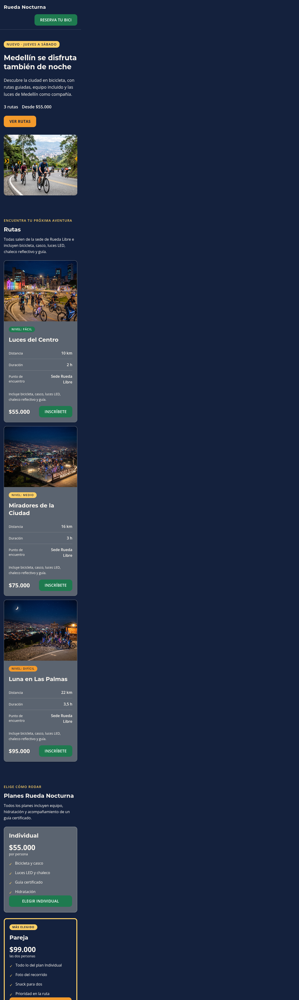
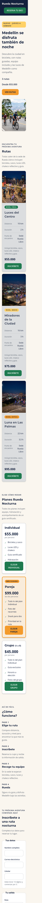

# Rueda Libre v2.0

Sitio web para conocer los servicios de alquiler y recorridos en bicicleta de Rueda Libre, en Medellín. El ecosistema incluye el sitio principal v2.0 y la landing promocional **Rueda Nocturna**, con planes, rutas e inscripción.

## Sitio publicado

- [Inicio](https://lezzier.github.io/rueda-libre/)
- [Tarifas y rutas](https://lezzier.github.io/rueda-libre/paginas/tarifas.html)
- [Reservas](https://lezzier.github.io/rueda-libre/paginas/reservas.html)
- [Landing Rueda Nocturna](https://lezzier.github.io/rueda-libre/nocturna/index.html)
- [Kit de componentes](https://lezzier.github.io/rueda-libre/nocturna/componentes.html)

## Páginas

- **Inicio:** campaña, catálogo de rutas y servicios.
- **Tarifas y rutas:** bicicletas, precios y recorridos guiados.
- **Reservas:** formulario con validación nativa, datos de contacto y horarios.
- **Rueda Nocturna:** rutas y planes Individual, Pareja («Más elegido») y Grupo, con acceso al formulario de inscripción.
- **Kit de componentes:** referencia de estilos, controles y estados visuales.

## Tecnologías

- HTML5 semántico y CSS.
- Bootstrap 5.3 para navegación y carrusel del sitio principal.
- Tailwind CSS 4.3 compilado y minificado para la landing nocturna.
- Google Fonts: Montserrat y Open Sans.
- GitHub Pages para publicación estática.

Para regenerar el CSS de Tailwind, instala las dependencias con `npm install` y ejecuta `npm run build`.

## Decisión de framework — MiniReto 8

Para un sitio con componentes comunes y patrones de interfaz conocidos, recomiendo **Bootstrap**: permite montar rápidamente una navegación responsive y componentes listos, como el carrusel. Para una landing con identidad propia y ajustes precisos de responsive y modo oscuro, **Tailwind** ofrece control granular mediante utilidades. El proyecto combina ambos según el uso de cada producto.

## Capturas

Vistas de la landing Rueda Nocturna capturadas localmente durante la revisión responsive:

### Escritorio

### Celular

### Modo oscuro

## Lista de verificación de entrega

- [x] HTML semántico, un `h1` por página e imágenes informativas con texto alternativo.
- [x] Formularios con etiquetas y validación nativa; campos requeridos vacíos se rechazan.
- [x] Navegación con teclado y foco visible; paleta y contraste documentados en la bitácora.
- [x] Sitio y landing comprobados a 360, 768 y 1280 px, sin desbordamiento horizontal ni imágenes fallidas.
- [x] Preferencias clara y oscura comprobadas en la landing.
- [x] Sin etiquetas `<style>` ni atributos `style` en las cuatro páginas principales.
- [x] Nu del W3C: cero mensajes al validar localmente la landing y Reservas; también comprobé las URLs públicas consultadas.
- [x] Rutas, anclas e imágenes locales revisadas; las páginas publicadas y los CSS respondieron HTTP 200.
- [x] `nocturna/src/output.css` regenerado y minificado con `npm run build`.
- [x] Los cambios de entrega están publicados; las URLs finales responden HTTP 200 y Nu del W3C no reporta errores en las páginas revisadas.

## Aprendizajes

- Elegir HTML semántico y validación nativa ayuda a que el contenido y los formularios sean comprensibles y utilizables con teclado.
- Grid resuelve distribuciones bidimensionales; Flexbox alinea elementos en una dimensión.
- El modelo de caja, `box-sizing: border-box`, espaciado consistente y breakpoints evitan desbordamientos.
- El contraste debe comprobarse en cada combinación de fondo y texto; los cambios visuales no deben depender solo del color.
- Bootstrap y Tailwind tienen enfoques diferentes y conviene elegirlos según el producto y la necesidad de personalización.

## Autor

[Juan José Gómez Ramírez](https://github.com/lezzier).